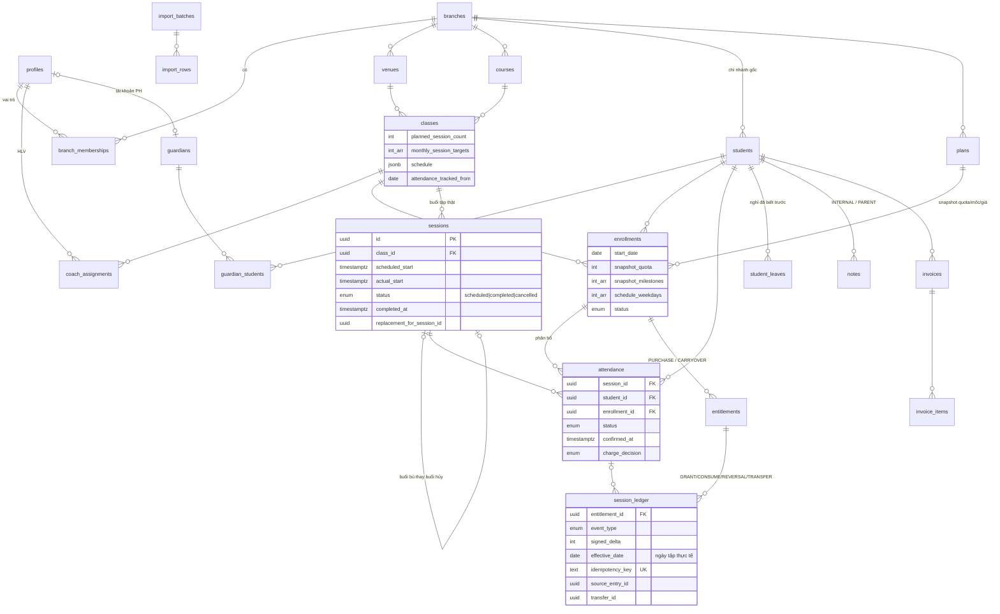

# ERD (đã triển khai trong `supabase/migrations`)

Bảng Phase 3 (receipts, expenses, advances, inventory, payroll, care_cases, notifications) giữ nguyên theo đặc tả mục 4 và sẽ được thêm ở migration riêng; hiện chỉ có khung `invoices`/`invoice_items`.

## Ràng buộc chính

- Composite FK đảm bảo `enrollments.(class, course, branch)` và `sessions.(class, course)` khớp nhau.
- `attendance` unique `(session_id, student_id)`; `session_ledger.idempotency_key` unique; ledger append-only (trigger chặn UPDATE/DELETE).
- Một buổi hủy có tối đa một buổi bù còn hiệu lực; buổi bù chỉ xác nhận được khi buổi gốc đã hủy.
- `completed` bắt buộc có `actual_start` và `completed_at`; `cancelled` bắt buộc có lý do.
- `STOPPED` bắt buộc có lý do và người xác nhận.
- Số dư quyền học = tổng `signed_delta` của ledger (không lưu cache).
